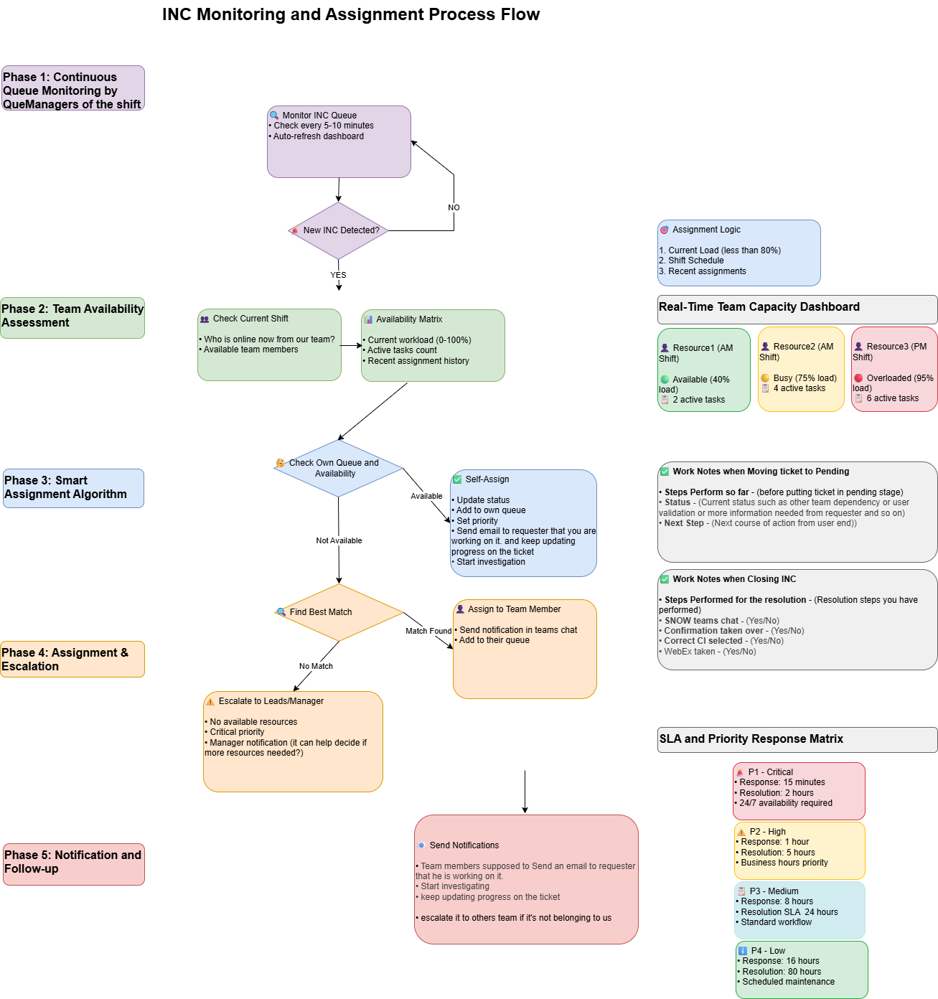

# INC Monitoring and Assignment Process

Comprehensive workflow for ServiceNow incident management, team assignment, and customer communication.

## 📊 Process Diagram

## 🎯 Problems Solved

- **🚨 Zero Missed Incidents** - Continuous monitoring every 5-10 minutes
- **⚖️ Workload Balance** - Smart assignment algorithm with capacity tracking  
- **🔄 Clear Ownership** - Systematic assignment prevents "hot potato" syndrome
- **📞 Communication** - Structured notifications with progress tracking
- **⏰ SLA Compliance** - Priority-based assignment with defined targets
- **🎯 Skill Matching** - Team availability matrix with experience consideration

## 📁 Files

| File | Format | Usage |
|------|---------|-------|
| [INC-Monitoring-Assignment.png](INC-Monitoring-Assignment.png) | Image | Direct viewing in GitHub |
| [INC-Monitoring-Assignment.drawio](INC-Monitoring-Assignment.drawio) | Editable | VS Code + Draw.io extension |
| [INC-Monitoring-Assignment-ASCII.txt](INC-Monitoring-Assignment-ASCII.txt) | Text | Terminal/command-line viewing |

## 🔄 5-Phase Workflow

### Phase 1: Queue Monitoring
- Monitor every 5-10 minutes by Queue Managers
- Auto-refresh dashboard for real-time visibility

### Phase 2: Team Assessment  
- Check current shift availability
- Real-time workload matrix (0-100%)

### Phase 3: Assignment Algorithm
- Self-check availability first
- Smart matching based on load, schedule, skills

### Phase 4: Assignment & Escalation
- Team assignment with notifications
- Escalate when no resources available

### Phase 5: Notification
- Email requesters with updates
- Progress tracking throughout lifecycle

## 📋 SLA Matrix

| Priority | Response | Resolution |
|----------|----------|------------|
| P1 Critical | 15 minutes | 2 hours |
| P2 High | 1 hour | 5 hours |
| P3 Medium | 8 hours | 24 hours |
| P4 Low | 16 hours | 80 hours |

## 📈 Expected Results

- **95%+ SLA Compliance** - Structured response times
- **Zero Lost Incidents** - Continuous monitoring
- **Balanced Team Load** - Fair distribution prevents burnout
- **Faster Resolution** - Right person assigned from start
- **Improved Satisfaction** - Proactive communication
- **Reduced Escalations** - Clear ownership

## 🚀 Implementation

1. **Train Queue Managers** on monitoring procedures
2. **Setup capacity dashboard** for real-time visibility  
3. **Create email templates** for consistent communication
4. **Establish escalation paths** and contact lists
5. **Monitor metrics** for continuous improvement

## 🔧 Required Tools

- ServiceNow (or similar ticketing system)
- Teams/Slack (notifications)
- Real-time dashboard (capacity monitoring)
- Email templates (customer communication)
- SLA monitoring system

## 📊 Success Metrics

- SLA Compliance: >95%
- Customer Satisfaction: >4.5/5
- Team Load Variance: <10%
- Response Time: 100% within SLA
- Escalation Rate: <10%

##  Key Features

- **Real-time capacity tracking** with color indicators
- **Assignment logic** based on load, schedule, skills  
- **Work notes templates** for pending and closure states
- **Progress notifications** throughout incident lifecycle
- **Cross-team escalation** for domain expertise

---

**Status**: ✅ Ready for Enterprise Implementation | **Version**: 1.0 | **Updated**: October 2025
